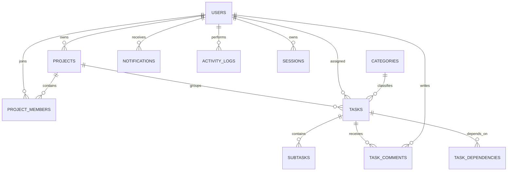

# Database ER overview

Private tasks have a nullable `project_id` and are restricted to their assigned user. Project tasks use `project_members` for shared access. Foreign keys, checks, and indexes are created by the database initialization migration routine.
